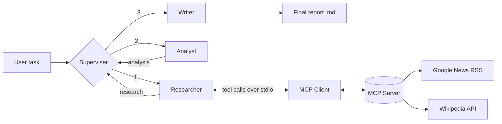

# 🤖 Supervisor Multi-AI-Agent System

A multi-agent AI application where a **Supervisor** coordinates a **Researcher**, an **Analyst** and a **Writer** to turn a single question into a structured, downloadable report. The Researcher uses **live news and Wikipedia data** through a custom **MCP (Model Context Protocol) server**, and every run can be traced end-to-end in **LangSmith**.

Built with **LangGraph, Groq (open-source LLMs), MCP, LangSmith and Streamlit**.

> 🔗 **Live demo:** _add your deployed link here (optional)_
> 🎥 **Demo video / screenshots:** _add here_

---

## 📌 Problem Statement

A single LLM prompt often gives shallow answers and relies only on its training data, so it can't talk about recent events. Real research work is split into steps: gather information, analyse it, then write it up.

This project mimics that workflow with specialised agents, each with one job, managed by a supervisor, and gives the Researcher access to live data so reports are not limited to the model's knowledge cutoff.

---

## ✨ Features

- **Multi-agent workflow** orchestrated with LangGraph (Supervisor → Researcher → Analyst → Writer)
- **Custom MCP server** exposing live-data tools (news and Wikipedia), with no paid API keys required
- **MCP client + tool-calling loop**: the LLM decides when to call tools, and the client forwards calls to the server
- **Graceful fallback**: if the MCP server or network fails, the Researcher answers from model knowledge and shows a warning instead of crashing
- **Deterministic routing guard-rail**: the pipeline order is enforced in code so agents can never loop forever
- **LangSmith observability**: enabled just by setting environment variables, with no custom tracing code
- **Streamlit UI**: choose the Groq model, set temperature, watch each agent's output live, and download the final report as Markdown
- **Secure key handling**: API keys are entered in the sidebar or loaded from `.env`, never hard-coded

---

## 🏗️ Architecture



| Agent | Responsibility |
|---|---|
| **Superviser** | Looks at the current state and assigns the next agent |
| **Researcher** | Gathers facts, trends, statistics and examples, using live tools when the topic is recent |
| **Analyst** | Extracts insights, risks, opportunities and recommendations from the research |
| **Writer** | Produces a structured executive report in Markdown |

### MCP roles

| Role | File | What it does |
|---|---|---|
| **Host** | `Superviser.py` (Researcher agent) | Owns the LLM and decides when tools are used |
| **Client** | `mcp_client.py` | Opens an MCP session, lists tools, forwards the LLM's tool calls |
| **Server** | `mcp_news_server.py` | Implements the tools and talks to external sources |

### MCP tools

| Tool | Purpose |
|---|---|
| `get_latest_news(query, max_results)` | Live headlines with source, date and link (Google News RSS) |
| `wikipedia_current_events()` | What is happening in the world today (Wikipedia Current events portal) |
| `wikipedia_search(query, max_results)` | Short background summaries from Wikipedia |

---

## 🛠️ Tech Stack

| Area | Technology |
|---|---|
| Language | Python 3.10+ |
| Agent orchestration | LangGraph, LangChain Core |
| LLM provider | Groq (Llama 3.3 70B, Llama 3.1 8B, GPT-OSS models) |
| Tool protocol | Model Context Protocol (`mcp`), stdio transport |
| Observability | LangSmith |
| UI | Streamlit |
| Data sources | Google News RSS, Wikipedia API |

---

## 📁 Project Structure

```
.
├── Superviser.py          # Streamlit app + LangGraph workflow (Supervisor, Researcher, Analyst, Writer)
├── mcp_client.py          # MCP client + tool-calling loop used by the Researcher
├── mcp_news_server.py     # MCP server exposing news and Wikipedia tools
├── requirements.txt       # Python dependencies
├── .env.example           # Template for environment variables
└── README.md
```

---

## 🚀 Getting Started

### 1. Clone the repository

```bash
git clone https://github.com/<your-username>/<your-repo>.git
cd <your-repo>
```

### 2. Create a virtual environment and install dependencies

```bash
python -m venv venv
# Windows
venv\Scripts\activate
# macOS / Linux
source venv/bin/activate

pip install -r requirements.txt
```

### 3. Add your API keys

Create a `.env` file (or type the keys into the app sidebar):

```env
GROQ_API_KEY=your_groq_key              # free at https://console.groq.com/keys

# Optional: LangSmith tracing
LANGSMITH_API_KEY=your_langsmith_key
LANGSMITH_PROJECT=Supervisor-Multi-Agent
```

### 4. Run the app

```bash
streamlit run Superviser.py
```

---

## 💡 Usage

1. Enter your Groq API key in the sidebar (and optionally a LangSmith key).
2. Pick a model and temperature.
3. Type a task, for example:
   - `What are the benefits of AI in Healthcare`
   - `Latest news on electric vehicles in India`
4. Click **🚀 Run Multi-Agent Team** and watch each agent work.
5. Read the final report and download it as a `.md` file.

For recent or breaking topics, the Researcher message shows which MCP tools were used, for example `Tools used: get_latest_news`.

---

## 🔍 LangSmith Tracing

Tracing needs no custom code. LangChain and LangGraph read these environment variables automatically:

```python
os.environ["LANGSMITH_TRACING"] = "true"
os.environ["LANGSMITH_API_KEY"] = "..."
os.environ["LANGSMITH_PROJECT"] = "Supervisor-Multi-Agent"
os.environ["LANGSMITH_ENDPOINT"] = "https://eu.api.smith.langchain.com"  # EU accounts only
```

Each run appears as one trace showing every agent step, prompt, tool call and token usage.

---

## 🧠 What I Learned

- Designing a **multi-agent system** with shared state and conditional routing in LangGraph
- Implementing the **Model Context Protocol** end to end: building a server, writing a client and connecting it to LLM tool calling
- Why **guard-rails** matter: LLM routing decisions can be unreliable, so the workflow order is enforced in code to avoid infinite loops
- Handling failures gracefully (network errors, unavailable tools) so the user always gets a result
- Adding **observability** with LangSmith to debug and understand agent behaviour
- Keeping secrets out of source code and structuring a project so each file has one clear responsibility

---

## ⚠️ Limitations

- The Researcher's quality depends on the news and Wikipedia sources and on the chosen model's tool-calling support.
- Live data comes from public endpoints with no guarantees on availability or completeness.
- Generated reports should be fact-checked before being used for anything important.

---

## 🔮 Future Improvements

- Add more MCP tools (web search, finance data, weather)
- Let the Supervisor genuinely choose agents dynamically, with validation
- Add a Reviewer / Critic agent that checks the report and requests revisions
- Export reports as PDF or Word
- Add automated tests for the MCP tools
- Deploy to Streamlit Community Cloud or Docker

---

## 👤 Author

**Your Name**
📧 your.email@example.com
🔗 [LinkedIn](https://linkedin.com/in/your-profile) · 💻 [GitHub](https://github.com/your-username)

If you like this project, please ⭐ the repository!
